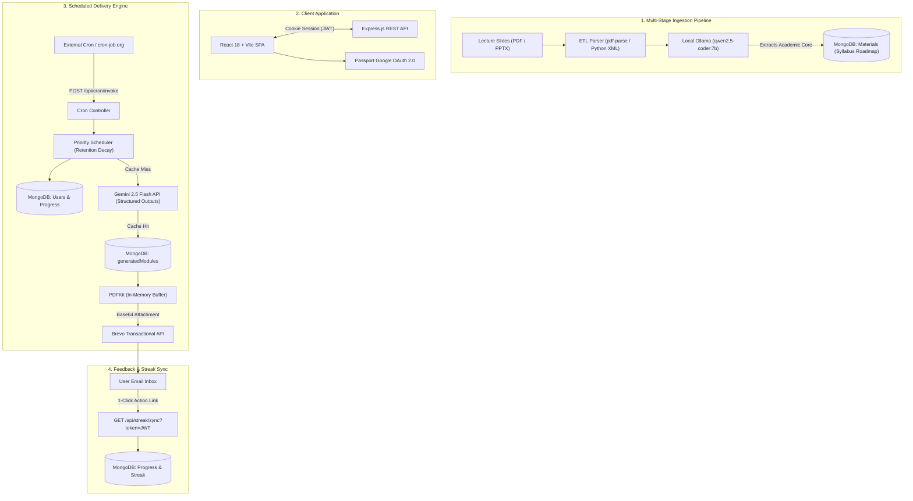

<div align="center">

# ⚡ Iterate

### Automated Spaced-Repetition & Interview Revision Engine for Computer Science

**Bite-sized, exam-focused syllabus modules and dynamically compiled PDF solution guides delivered straight to your inbox.**

[](https://nodejs.org/)
[](https://react.dev/)
[](https://expressjs.com/)
[](https://www.mongodb.com/)
[](https://ai.google.dev/)
[](https://www.brevo.com/)

[Live Application](https://iterate-app.me) • [Backend API](https://api.iterate-app.me) • [Report Bug](https://github.com)

</div>

---

## 📌 The Problem: The Semester Trap

Every semester, computer science undergraduates are bombarded with **3 to 4 intensive, fast-paced courses**. Between lab reports, midterm exams, programming assignments, and project deadlines, 100% of a student's mental bandwidth is consumed just staying afloat in their current semester.

The inevitable consequence? **Severe knowledge decay.**
* Concepts mastered in semester 2 (OOP, Linear Data Structures) fade by semester 4.
* Heavy systems concepts (Operating Systems, Networks, Database Internals) blur into memory by the time senior-year technical interview season arrives.
* Students find themselves forced to re-study entire multi-month courses from scratch—an overwhelming task while still managing a full academic course load.

---

## 🎯 The Solution: 10 Minutes a Day to Keep Fundamentals Evergreen

**Iterate** was built to break this cycle. Its core philosophy is simple: **Give 10 minutes a day to build a sustainable revision habit that keeps previous semester knowledge evergreen while you freely pursue new courses.**

Instead of letting hard-earned fundamentals fade, Iterate acts as an automated background maintenance loop:
1. **Curriculum Distillation:** Converts university lecture decks into concise, high-yield, 5-minute markdown summaries focused strictly on exam and interview essentials.
2. **Decay-Based Priority Scheduling:** Tracks retention decay over time, automatically prioritizing topics right before they slip out of memory.
3. **Daily Inbox Delivery:** Sends bite-sized daily revision directly to your email, complete with practice MCQs and an in-memory **PDF Solution Key**.
4. **Frictionless Feedback Loop:** One-click action buttons inside the email (`Aced`, `Confused`, `Report`) update your learning streak and adapt your revision schedule without requiring you to log in to an app.

---

## ⚡ Why Not Just Use ChatGPT?

A common question is: *“Can’t I just ask ChatGPT to review these topics?”*

Technically, yes—but in reality, **raw LLMs introduce significant friction and cognitive overhead**:

| Dimension | Using ChatGPT / Raw LLMs | Using Iterate |
| :--- | :--- | :--- |
| **Cognitive Overhead** | **High:** You must decide what to study, plan the syllabus, and craft prompts daily. | **Zero:** You don't have to plan or think—the exact topic you need lands in your inbox every morning. |
| **Content Format** | **Walls of Text:** Produces broad, verbose blog-style outputs that take 20+ minutes to read. | **Bite-Sized & Curated:** Strict 5-minute markdown refreshers aligned directly with your university slides. |
| **Spaced Repetition** | **None:** ChatGPT doesn't know when you last reviewed a topic or which concepts you find difficult. | **Mathematical Decay Engine:** Schedules topics based on your confidence score and time elapsed since last review. |
| **Habit & Friction** | **Pulls Attention:** Requires the willpower to remember to open ChatGPT, formulate prompts, and navigate chats. | **Pushed to You:** Arrives automatically in your inbox. Read for 5 minutes, solve 2 MCQs, click `Aced`, and you’re done. |

Iterate eliminates the planning fatigue so you can focus entirely on keeping your fundamentals razor-sharp in just **10 minutes a day**.

---

## 🏗️ System Architecture

Iterate is structured as an event-driven system with separated concerns for content ingestion, scheduling, transactional dispatch, and web presentation:



---

## 💡 Core Engineering Highlights

### 1. Spaced Repetition Retention Decay Engine
Instead of basic sequential ordering or random picking, Iterate dynamically serves topics using a mathematical decay formula in [`prioritySchedular.js`](server/engines/prioritySchedular.js):

$$\text{Priority Score} = \frac{\text{Confidence Score}}{\Delta t_{\text{hours}}}$$

* **Retention Weight:** High confidence topics (`10/10`) decay slowly; low confidence topics drop rapidly.
* **Selection:** The scheduler queries active courses and serves the topic with the **minimum priority score**, targeting concepts right before they fade from memory.

### 2. Two-Stage Heterogeneous LLM Pipeline
To balance cost, privacy, and output fidelity, Iterate divides generative AI across two distinct layers:
* **Stage 1 (Offline Distillation):** Heavy university slide decks (PDFs and `.pptx` presentations) are parsed and passed to a local **Ollama** model (`qwen2.5-coder:7b`). It extracts formulas, definitions, and code structures into clean context objects while ignoring academic boilerplate.
* **Stage 2 (Online Generation & Cache):** At runtime, if a topic is not yet compiled, the distilled context is sent to **Google Gemini 2.5 Flash** using strict native **JSON Schema enforcement (`responseSchema`)**. Gemini generates a markdown lesson body, recruiter-focused interview relevance, and 2 verified MCQs. Results are permanently cached in MongoDB to ensure near-zero ongoing API cost.

### 3. Ephemeral In-Memory Asset Generation
To deliver formatted solution keys without burdening disk I/O or managing temporary files on ephemeral cloud containers (e.g. Render):
* Solution manuals are dynamically rendered in memory using **`PDFKit`** binary streams.
* The resulting `Buffer` is encoded directly into base64 and handed off to Brevo's transactional email payload, leaving **zero disk footprint**.

### 4. Frictionless 1-Click Action Tokens
Requiring users to log in to record study progress kills habit formation. 
* Iterate signs tamper-proof, short-lived **JWT Link Tokens** (`userId`, `courseCode`, `order`) into the email's action buttons (`Aced`, `Confused`, `Report`).
* Clicking an action instantly advances progress, updates streaks, or routes difficult questions into the user's **Confused Vault** with a single click.

### 5. Resilient Non-Blocking Cron Architecture
Long-running jobs (such as syncing multi-company interview guides) are built with an asynchronous **`202 Accepted` Fire-and-Forget** pattern with concurrency locks:
* Prevents upstream HTTP proxy timeouts (Cloudflare / Render / cron-job.org).
* Processes heavy background tasks safely with exponential rate-limit backoffs.

---

## 🛠️ Tech Stack

| Domain | Technology | Description |
| :--- | :--- | :--- |
| **Frontend** | React 18, JavaScript (ES6+), Vite | Modern component tree, custom revision roadmap visualizer, CSS tokens |
| **Backend** | Node.js, Express.js (ESM) | REST API, Passport.js Google OAuth, JWT in `httpOnly` secure cookies |
| **Database** | MongoDB Atlas, Mongoose | Schema-enforced document store with compound indexes |
| **AI / LLMs** | Google Gemini 2.5 Flash, Ollama | Structured outputs via `@google/genai`, local slide extraction |
| **Email & Assets**| Brevo API, PDFKit | Transactional email dispatch, on-the-fly binary PDF generation |
| **DevOps & Tasks**| Render, Vercel, Node-Cron | Containerized web service, serverless cron triggers |

---

## 📂 Repository Structure

```
RevisionApp/
├── client/IterateApp/          # React + Vite Frontend
│   ├── api/cron/               # Serverless cron triggers
│   ├── src/                    # Components (LiveRevisionTree, Topics, AuthContext)
│   └── styles/                 # Design tokens and UI styles
├── server/                     # Express REST API Backend
│   ├── config/                 # Passport strategies & Brevo transporter
│   ├── controllers/            # Auth, Streak, Materials, User controllers
│   ├── engines/                # Priority scheduler, PDF compiler, LLM generators
│   │   ├── buildPDF.js         # In-memory PDF generator
│   │   ├── fetchGenerate.js    # Cache-layer generator
│   │   ├── generateContent.js  # Gemini 2.5 Flash structured generator
│   │   ├── generateSyllabus.js # ETL pipeline & course roadmaps
│   │   └── prioritySchedular.js# Spaced repetition decay algorithm
│   ├── etl-processor/          # Raw course slide storage & extraction scripts
│   ├── models/                 # Mongoose schemas (Materials, Progress, Users, Guides)
│   ├── Routes/                 # Modular API routes
│   └── utils/                  # Mailer worker, DB connectors, link token signers
└── README.md
```

---

## 🚀 Local Development Setup

### Prerequisites
* [Node.js (v20+)](https://nodejs.org/)
* [MongoDB](https://www.mongodb.com/) (Local or Atlas URI)
* [Ollama](https://ollama.com/) (Optional: only needed for running offline slide extraction)

### 1. Clone & Install Dependencies
```bash
git clone https://github.com/your-username/iterate.git
cd iterate

# Install server dependencies
cd server
npm install

# Install client dependencies
cd ../client/IterateApp
npm install
```

### 2. Configure Environment Variables
Create a `.env` file in the `server` directory (refer to [`server/.env.example`](server/.env.example)):

```env
PORT=1700
CLIENT_URL=http://localhost:5173
BASE_URL=http://localhost:1700

MONGODB_URI=your_mongodb_connection_string
JWT_SECRET=your_random_secret_hex

GOOGLE_CLIENT_ID=your_google_oauth_client_id
GOOGLE_CLIENT_SECRET=your_google_oauth_client_secret

GEMINI_API_KEY=your_gemini_api_key
EMAIL_USER=study@iterate-app.me
EMAIL_PASS=your_brevo_smtp_key

CRON_SECRET=your_cron_authorization_secret
```

### 3. Run the Development Environment

Start the backend:
```bash
cd server
npm run dev
```

Start the frontend:
```bash
cd client/IterateApp
npm run dev
```

Visit `http://localhost:5173` to explore the application.

---

## 📚 Supported Courses

* **CSE111:** Object-Oriented Programming
* **CSE220:** Data Structures
* **CSE221:** Algorithms
* **CSE321:** Operating Systems
* **CSE421:** Computer Networks

---

## 📄 License

This project is open-source under the [ISC License](LICENSE).
